<p align="center">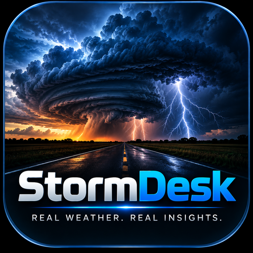</p>

# StormDesk

**Your forecast. Your sky.** StormDesk opens with Forecast desk: ten animated forecast cards, a readable hourly outlook, compact astronomy, eight larger Orbit Glass gauges, and a bold seconds clock. The full [HookEcho](https://hookecho.io/) radar viewer and station history are one click away. Start with a location; connect a personal weather station when you’re ready. Free and open source, with no StormDesk account, ads, or subscription.

[Open the app](https://app.mystormdesk.com/) · [Download 4.8.1](https://github.com/d4vid87/stormdesk/releases/tag/v4.8.1) · [Website](https://mystormdesk.com/) · [Setup & help](https://mystormdesk.com/help.html) · [Release notes](CHANGELOG.md)

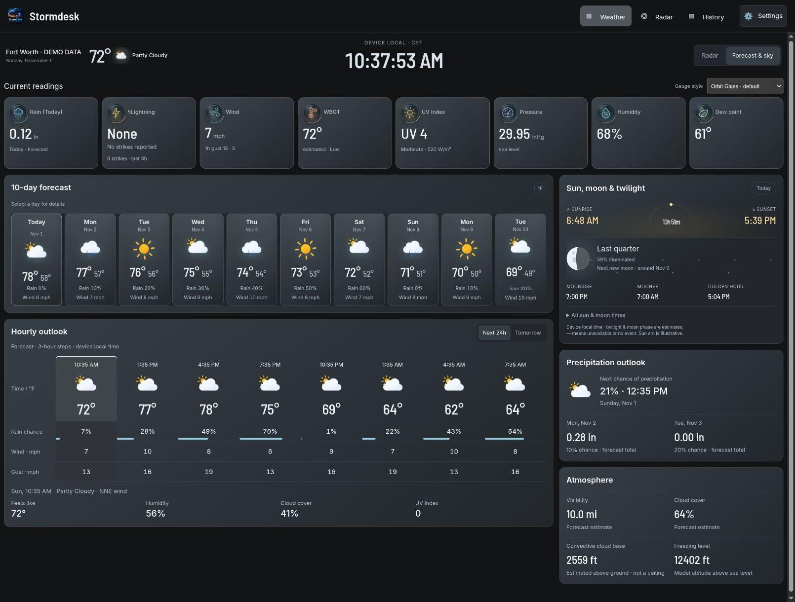

*The 4.8.0 opening view, captured November 1, 2026 with labeled demo readings. Screenshots are not current weather.*

### What’s new in 4.8.1

- Fix duplicate startup and conflicting settings saves that repeatedly rebuilt the dashboard.
- Adapt Auto motion to Linux software rendering while keeping Full motion selectable.
- Reduce forecast animation work and fill wider and taller browser windows.

### What’s new in 4.8.0

- **Forecast desk:** all ten forecast days near the top, larger live gauges, and a centered hours/minutes/seconds clock.
- **Readable hourly weather:** select the next 24 hours or tomorrow; inspect temperature, precipitation chance, wind, gusts, feels-like temperature, humidity, cloud cover and UV.
- **More useful context:** upcoming precipitation, daily totals, visibility, cloud cover, estimated convective cloud base and freezing-level altitude. Coverage depends on the provider; unavailable readings stay clearly marked.
- **Compact astronomy:** sunrise, sunset, daylight, moon phase, moonrise/set, golden hour and expandable twilight times beside the forecast.
- **Five gauge styles:** Orbit Glass remains the default. Existing units, themes and reduced-motion settings are preserved.
- **Full HookEcho radar:** switch to the actual viewer whenever needed. It unloads when you return to Forecast & sky.

### Choose your setup

| Start in the browser | Run your own host |
| --- | --- |
| Open [app.mystormdesk.com](https://app.mystormdesk.com/), choose a location, and use forecasts, radar, and supported cloud station data. | Install the desktop app, Linux browser-mode package, or Docker image to collect supported station readings and keep your archive locally. |
| This browser keeps its own settings. No StormDesk account is required. | Leave the host running for collection and household screens. Use `/public` for read-only access. |

Forecast and radar services need internet access. Station connection methods vary by platform; see [compatibility](https://mystormdesk.com/compatibility.html). [StormDesk Lite](https://app.mystormdesk.com/lite/) remains available for older browsers and lighter displays.

## Install StormDesk

Open the [latest release](https://github.com/d4vid87/stormdesk/releases/latest), then choose the
file for your device.

| Your device | File to choose | What to do |
|---|---|---|
| Windows 10 or 11 | `StormDesk_*_x64-setup.exe` | Open the file and follow the installer. Allow access on private networks when Windows asks. |
| Mac | `StormDesk_*_universal.dmg` | Open the file, then drag StormDesk into Applications. |
| Ubuntu, Debian, or Linux Mint | `StormDesk_*_amd64.deb` | Double-click the file, or use the short command below. |
| Other 64-bit Linux computers | `StormDesk_*_amd64.AppImage` | Make the file runnable, then open it. See the short command below. |
| Raspberry Pi 4 or 5 | `StormDesk_*_arm64.deb` | Use a 64-bit Raspberry Pi system, then install it with the short command below. |
| Android or Fire tablet | `StormDesk_v*.apk` | Open the file and allow installation from your browser or Files app when asked. |

If a Mac says it cannot verify StormDesk, open **System Settings → Privacy & Security** and choose
**Open Anyway**.

### Linux commands

<details><summary>Optional local voice setup and spoken alerts</summary>

For the optional **natural male voice** (Kokoro Michael), install [uv](https://docs.astral.sh/uv/),
then run `python3 scripts/install-natural-voice.py` from this repository. Setup downloads about
350 MB once; speech then runs locally on the CPU without an account or cloud service. An installed
`pw-play`, `paplay`, or `aplay` provides audio playback. Restart StormDesk and use **Enable / Test voice**;
the setting shows **Natural male voice · local** when ready. The ordinary system voice remains available
on installations without the voice pack. If an installed voice pack fails, the app reports the error
instead of silently changing back to the robotic voice.

Spoken watches and warnings: open **Settings → Alerts & sound → Warnings & voice**, enable **Read warnings and watches aloud**,
then press **Enable / Test voice**. Keep the dashboard open. The status below the button explains
blocked playback or missing voices; the test does not send push notifications.

The Linux app falls back to the local `espeak-ng` engine when browser speech cannot start.
Debian and Arch packages install it as a dependency. AppImage users should install `espeak-ng`
with their package manager (for example, `sudo apt install espeak-ng` or `sudo pacman -S espeak-ng`).
Browser mode uses the browser's speech engine and may require a system voice and an initial tap.
On Linux, browser speech may also require `speech-dispatcher` and `espeak-ng`; restart the browser
after installing them. An embedded browser without speech support reports an error instead of
claiming an announcement played; use the Linux app's native fallback in that case.
Warnings and watches bypass quiet hours just as official alert notifications already do; routine
advisories stay silent. Closed-app and locked-phone announcements are not supported.

</details>

For Ubuntu, Debian, or Linux Mint:

```sh
sudo apt install ./StormDesk_*_amd64.deb
```

For a 64-bit Raspberry Pi:

```sh
sudo apt install ./StormDesk_*_arm64.deb
```

For the AppImage:

```sh
chmod +x StormDesk_*_amd64.AppImage
./StormDesk_*_amd64.AppImage
```

To build a local AppImage from source, run `bash scripts/build-appimage.sh` with Docker
running. It builds in Ubuntu 22.04, matching the release workflow and avoiding Arch's
newer GTK loader layout and incompatible bundled strip tool. The unsigned preview is
written to `src-tauri/target/appimage-ubuntu/release/bundle/appimage/`. Build caches stay
under `~/.cache/stormdesk-appimage`; no host packages are changed. Published, signed
updater artifacts still come from the GitHub release workflow.

If the AppImage opens a blank window, use browser mode:

```sh
./StormDesk_*_amd64.AppImage --browser
```

Linux releases also include a browser-mode archive for x86-64 and ARM64. Extract it and run
`stormdesk-browser.sh` to keep the station collector and archive local while showing the full
dashboard in your system browser. This build needs no GTK or WebKit installation.

### Chromebook

The easiest option is to run StormDesk on another computer in your home, then open the address
shown by StormDesk in the Chromebook browser. If Linux is enabled on your Chromebook, use the
browser-mode archive matching its CPU architecture. Chromebook and Samsung hub browsers open
StormDesk Lite by default; choose **Full dashboard** there if the device can handle it.

## Set it up

1. Open StormDesk and search for your town or postcode.
2. Choose the matching location to see current conditions and the forecast.
3. If you have a personal station, connect it under **Settings → My station**.

The top metrics stay in this order: **Rain, Lightning, Wind, WBGT, UV Index, Pressure, Humidity, Dew point**. Station readings appear where available; forecast estimates and unavailable measurements are labeled. The forecast list shows up to ten days, depending on what the provider supplies.

Tempest owners need a personal-use token from **tempestwx.com → Settings → Data Authorizations**.
StormDesk can find the stations connected to that token, so you do not need to hunt for sensor
numbers.

Other supported stations send readings directly from your home network. StormDesk shows the exact
address to enter in your station's app or console.

Don't own a weather station? Choosing a location is enough to use the forecast dashboard.

## Use it around your home

The desktop app shows an address such as `http://192.168.1.20:8088` in its window title. Open that
address on another device connected to the same Wi-Fi. Leave StormDesk running on the main
computer so the other screens can reach it.

Use the address ending in `/public` for a read-only screen that cannot change settings.

## What you get

- **Weather** — Forecast desk opens first with eight larger gauges, up to ten forecast days, hourly weather, compact astronomy and atmospheric context. Toggle the full HookEcho radar on when needed.
- **Local context** — nearby official alerts, local signals, sunrise and sunset, moon details, and device health when the source provides it.
- **Radar** — live HookEcho radar with warnings and playback.
- **History** — keyboard-accessible charts and reading tables, records, comparisons, rainfall events, and your weather archive.
- **More weather details & analysis** — additional charts, the timeline, and advanced weather tools remain accessible from Weather.
- **Alerts** — built-in warnings plus your own rules for wind, rain, heat, cold, and more.
- **Backup** — one backup file for your settings and the selected station's history, notes, and extra sensors. Back up each saved station separately.

## Explore your station history

Open **History → Archive review, notes & reports** and load a period of one to seven days.

- Review suspicious readings, record a reason before excluding them, and use **Restore readings** to undo an exclusion. Original observations remain in the archive.
- Add maintenance notes, snowfall, or snow-depth measurements; inspect missing periods and recover supported Tempest or Ecowitt cloud history.
- Preview a CSV import with its source units and time zone before saving. Existing timestamps are retained.
- Explore rain events, an hourly temperature heatmap, and a seasonal rainfall calendar. Load a monthly or annual report, then use **Print / save PDF**.

**History → Additional sensors** shows supported indoor, soil, air-quality, and battery channels. Select a sensor to inspect its chart/table or save a threshold alert. The station server evaluates these alerts while the page is closed.

Use **Remember this station** in Settings after configuring each station. The header switch selects its separate archive and settings; collection follows the selected station. Removing a saved profile does not delete its archive.

Under **Settings → More tools → Weather sources, sensors & camera**, choose a forecast model and official warning source for the selected place. Optional Weather panels show pollen, local PurpleAir readings, a NOAA river gauge, a camera snapshot, and outdoor activity windows. Coverage and setup requirements are in [Additional weather sources](docs/provider-setup.md); detailed archive instructions are in the [technical reference](docs/technical-reference.md#archive-review-and-sensor-history).

## See the current app

| Dedicated Radar | Station History |
| --- | --- |
| 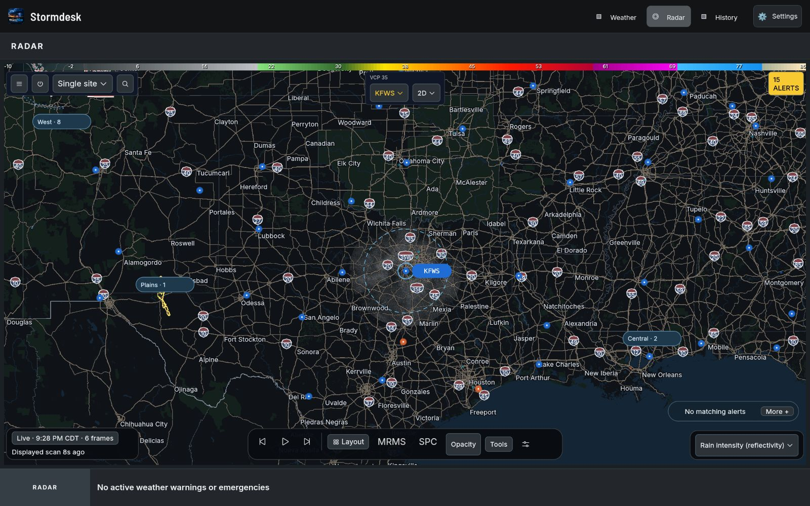 | 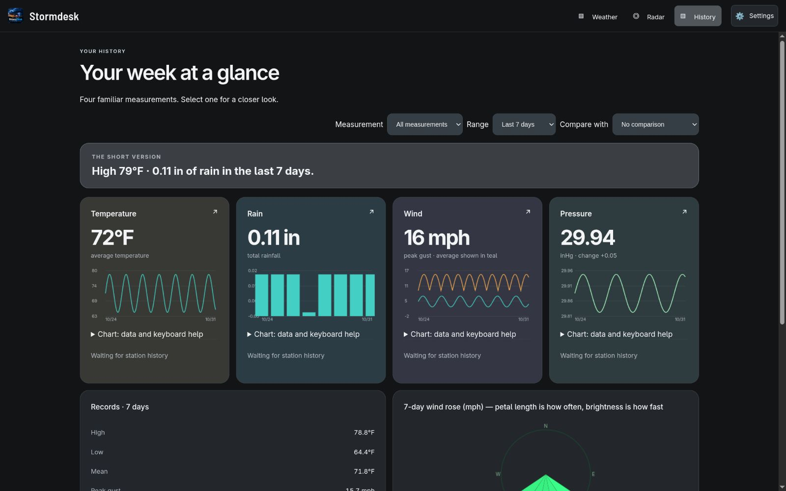 |

| Forecast & sky | Searchable Settings |
| --- | --- |
|  | 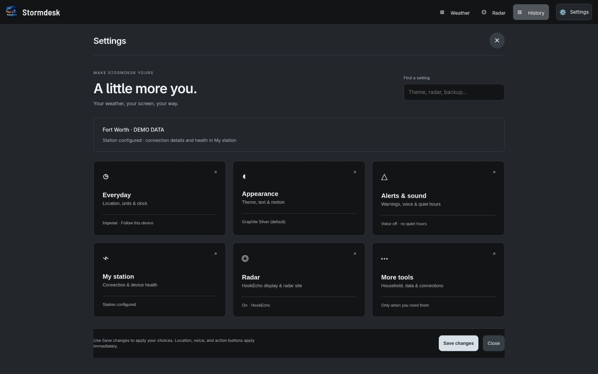 |

### Five gauge styles

Use **Gauge style** above the radar. These static close-ups show the first four gauges; the app includes animations for all eight.

| Style | Preview |
| --- | --- |
| **Orbit Glass · default** | 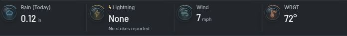 |
| Liquid Chrome | 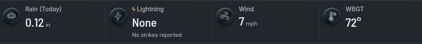 |
| Neon Trace | 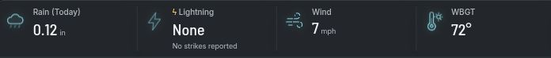 |
| Precision Dial | 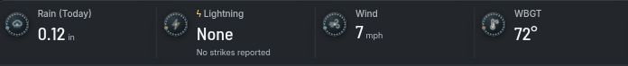 |
| Pixel Pulse | 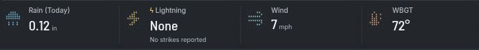 |

Graphite Silver is the fresh-install palette. **Settings → Appearance → Theme** includes nine more dark palettes and classic light, high-contrast, and e-ink choices. Saved preferences are preserved.

### On your phone

The compact gauge shelf scrolls horizontally, leaving room for the map. Weather, Radar, and History remain one tap away.

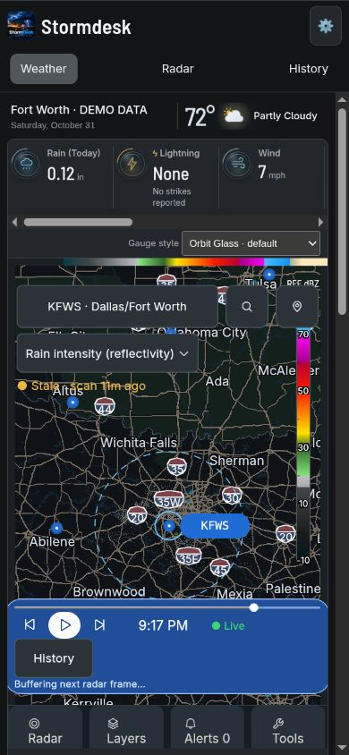

All interface captures above use sample station data. Forecast, sensor, and regional alert availability depend on the connected sources.

## Supported weather stations

- WeatherFlow Tempest
- Ecowitt and Wittboy
- Ambient Weather
- Davis WeatherLink Live
- AcuRite through `rtl_433`
- La Crosse Technology
- WeeWX
- Many stations that can send data in Weather Underground format
- Forecast-only mode when no station is available

Brand-by-brand instructions are in the
[technical guide](docs/technical-reference.md#other-weather-stations).

## Need help?

Open **Settings → More tools → Troubleshooting → Diagnostics** or the **Health Center**. StormDesk checks your station, forecast,
alerts, radar, saved history, and other connections. **Copy support report** creates a safe report
you can paste into a GitHub issue without including passwords, tokens, or your location.

Common fixes:

- **No readings:** reopen the welcome setup and make sure it receives one real reading.
- **Another screen cannot connect:** keep StormDesk running and allow it through the main computer's firewall on private networks.
- **Blank Linux window:** start StormDesk with `--browser`.
- **Old or missing forecast:** open the Health Center and choose **Retry now**.

If you are still stuck, [report a problem](https://github.com/d4vid87/stormdesk/issues/new) and
include the support report.

## For technical users

The [technical guide](docs/technical-reference.md) covers Docker, Home Assistant, MQTT, alert
services, read-only sharing, station upload formats, building from source, data sources, testing,
and troubleshooting.

- [Home Assistant guide](docs/homeassistant.md)
- [WeeWX guide](docs/weewx.md)
- [Security policy](SECURITY.md)
- [Changes in each release](CHANGELOG.md)

## Privacy

StormDesk stores its settings and weather history on your own computer. It has no user accounts,
ads, or app tracking. Forecast and alert providers receive only the information needed to return
weather for your area.

The regular home-network dashboard is meant for people you trust. Use `/public` for guests or any
screen that should not see or change private settings.

## License

StormDesk is free and open source under the [MIT License](LICENSE).
