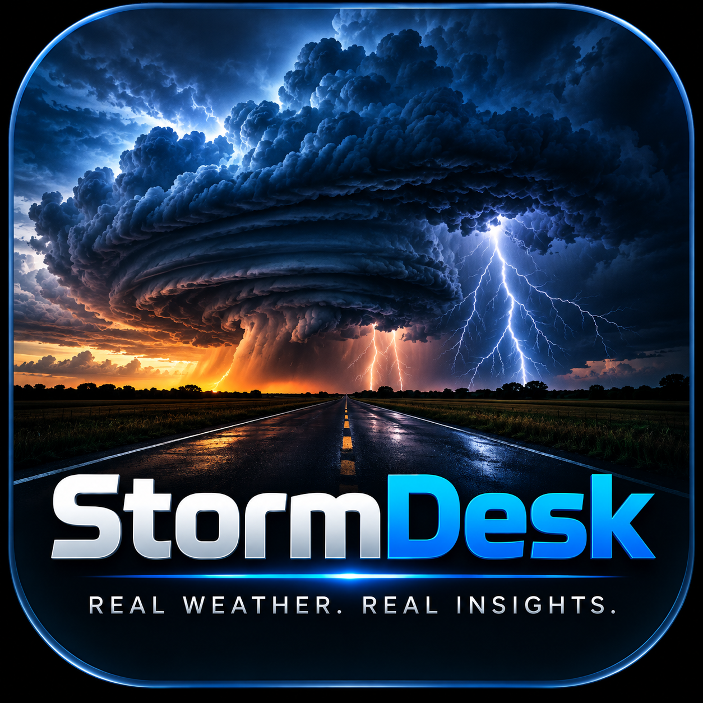
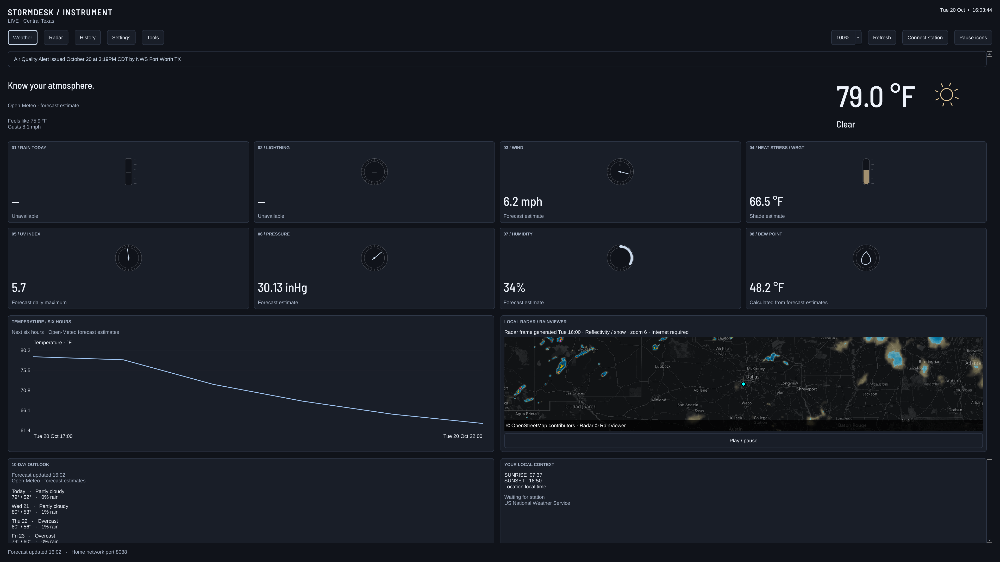

<p align="center"></p>

# StormDesk

A C++17 / Qt 6 weather application for desktop computers, Raspberry Pi, and Android tablets. The dashboard, history, settings, and advanced tools use native Qt widgets. HookEcho radar embeds through Qt WebEngine on desktop builds; builds without WebEngine open it in the system browser. No Rust or Tauri toolchain is needed to build StormDesk.

Choose a location for forecasts, or connect a personal weather station for measurements. StormDesk supports WeatherFlow Tempest, Ecowitt, Ambient Weather, Davis WeatherLink Live, La Crosse, and compatible Weather Underground upload protocols. Missing readings stay unavailable; forecast estimates are labeled.

The native **Instrument** interface has eight measurement faces, animated weather icons, an animated sunrise/sunset strip with location-local times, and live HookEcho radar below a compact, collapsible native strip. The smaller gauges sit in one row above the radar’s color scale on large screens. Drag their handles to reorder them; the order is saved on each device. The STORMDESK header and Dashboard tab match the hosted app, with enlarged current conditions, an illustrated sunrise/sunset horizon, and radar-colored National Weather Service banners. Station connection and icon animation controls live in Settings. A large clock sits in the upper-right corner, with the date beneath it. First-run onboarding imports a Tempest station from its WeatherFlow token, then automatically uses the station’s location for local warnings and NEXRAD WSR-88D radar. Other station types have source-specific connection steps. Setup verifies the real feed and saves display preferences. Saved **70–200% scaling**, automatic display DPI, touch scrolling, themes, and dashboard customization support different screens. The same CMake project builds a native GUI or a small headless collector/server.



## Build

Install CMake 3.21+, a C++17 compiler, and Qt 6.4+ Core, Network, SQL/SQLite, Widgets, and Test. On Debian/Ubuntu:

```sh
sudo apt install build-essential cmake pkg-config qt6-base-dev libqt6sql6-sqlite libmosquitto-dev
cmake -S . -B build -DCMAKE_BUILD_TYPE=Release
cmake --build build --parallel 2
ctest --test-dir build --output-on-failure
./build/stormdesk
```

Qt TextToSpeech adds system voices. libmosquitto 2.0+ enables MQTT and Home Assistant discovery. The [native build and migration guide](docs/native-cpp.md) covers Windows/macOS deployment, Raspberry Pi, Android/OpenSSL, Docker, UI scaling, APIs, and backups.

For a disposable demonstration:

```sh
./build/stormdesk --demo --port 0
```

For a server without desktop libraries:

```sh
cmake -S . -B build-headless -DSTORMDESK_GUI=OFF -DCMAKE_BUILD_TYPE=Release
cmake --build build-headless --parallel 2
./build-headless/stormdesk --headless --data-dir /path/to/data
```

## Native weather tools

- Animated radar with pan, zoom, playback, and coverage mask.
- Hourly outlook, precipitation guidance, model comparisons, ensemble percentiles, weather timeline, forecast changes, and accuracy tracking.
- Sun/moon, solar energy, air quality, fire/dryness, garden water balance, severe outlooks, snow, tropics, storm reports, and drought maps.
- Station history, archive explorer, all-time/monthly records, wind rose, climate normals, and official forecast comparison.
- Nearby sensors, notification history, Home Assistant/MQTT boards, source diagnostics, saved places, and dashboard customization.
- Native station setup, compound alert rules, notifications/speech, CSV, backup inspection/recovery/restore, legacy JSONL import, and LAN pairing.

Forecast and environmental guidance uses Open-Meteo and regional official sources. Radar is provided by the live HookEcho application with its own source attribution and scan times. Data requires an internet connection; archive, settings, and local station collection work locally. The C++ HTTP server also serves the existing browser companion to LAN screens.

## Migration status

This branch is a native migration build. Windows, macOS, Linux x86-64/ARM64, and Android ARM64 builds are checked in [native CI](.github/workflows/native.yml). Build success does not establish physical-device acceptance. The native preview packages include a signed Android APK, tested with actual Tempest readings on a Galaxy S24 Ultra running Android 16. Settings → App updates checks for official native releases automatically; installation remains explicit. Windows/macOS vendor signing is prepared but requires accounts/certificates, and physical Windows/Mac/Pi acceptance remains pending. See [release acceptance](docs/native-release-readiness.md) for the remaining checks.

Keep a complete backup and the old app until your station and devices are verified. The native app uses its own data directory by default, preserves the SQLite observation schema and format-1 backups, and creates recovery backups before replacing data. The old `src-tauri/` source and manual legacy release workflow remain for rollback.

[Build and migration guide](docs/native-cpp.md) · [Report an issue](https://github.com/d4vid87/stormdesk/issues)
